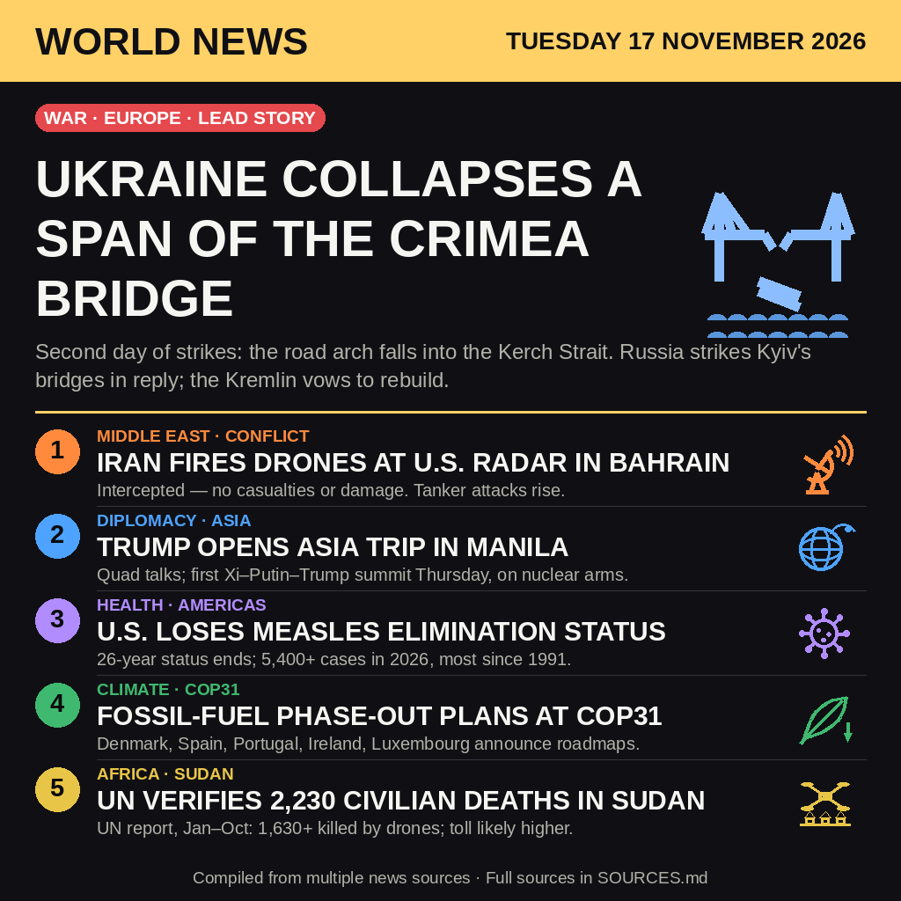

# World News — Tuesday 17 November 2026, in one image

Entry for the make.fun bounty **news-image-20261117**: sum up 17 November
2026's world news in a single image.

## What's in the image

One lead story plus five supporting stories, each verified against at least
two independent sources (full research log in [SOURCES.md](SOURCES.md)):

1. **Lead — War · Europe:** Ukraine collapses a span of the Crimea Bridge.
2. **Middle East:** Iran fires drones at a U.S. radar in Bahrain.
3. **Diplomacy · Asia:** Trump opens his Asia trip in Manila.
4. **Health · Americas:** The U.S. loses measles elimination status.
5. **Climate · COP31:** Fossil-fuel phase-out plans pledged at COP31.
6. **Africa · Sudan:** UN verifies 2,230 civilian deaths in Sudan.

## How it was made

The image was researched and rendered ahead of time with a deterministic
Python/Pillow renderer (`build/render.py`, fonts bundled under
`build/fonts/`). Three layout variants were compared judge-style; the
winning variant and the fixes applied to it are documented in
[EVAL.md](EVAL.md).

## Program

`main.py` is the competition entrypoint. It copies the bundled
`entry.png` to `/output/entry.png` — no network, no clock, no randomness,
so repeated runs produce byte-identical output.

## License

MIT — see [LICENSE](LICENSE). The bundled Liberation Sans fonts are
licensed under the SIL Open Font License 1.1 (see `build/fonts/OFL.txt`).
